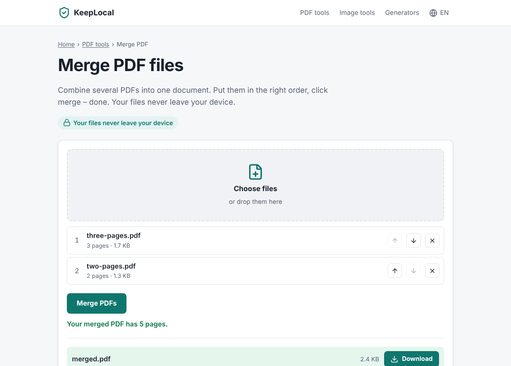

# KeepLocal – free PDF & image tools that never upload your files

A website with free online tools – merge PDFs, compress photos, create QR codes and more –
that run **100 % inside the visitor's browser**. Files are never uploaded. That makes the site
private for visitors and almost free to run for you: there is no server, no database and no
user data to look after.



- **How it makes money:** display ads (Google AdSense, later better-paying networks), affiliate
  recommendations (e.g. a password manager next to the password generator) and voluntary tips.
  Ads, tips and statistics are switched on for all sites of the network in
  [`packages/shared/src/network.ts`](../../packages/shared/src/network.ts); KeepLocal's ad units and
  affiliate offers are in [`src/config.ts`](src/config.ts).
- **How it grows:** every tool in every language is its own page that can be found on Google.
  Today: 20 tools × 2 languages (English, German) = 40 tool pages. A new language multiplies
  all of them – see [docs/ADDING-TOOLS.md](docs/ADDING-TOOLS.md).
- **Why this idea?** Research, numbers and honest risks: [docs/STRATEGY.md](../../docs/STRATEGY.md)
- **Going live:** [docs/LAUNCH-CHECKLIST.md](../../docs/LAUNCH-CHECKLIST.md) (for all sites of the network)

## The tools

| PDF | Images | Generators |
| --- | --- | --- |
| Merge PDF · Split PDF · Rotate PDF · Delete pages · JPG → PDF · PDF → JPG | Compress · Resize · Image converter (+ 6 pages like "PNG to JPG") · Remove EXIF/GPS data · Image to text (OCR) | QR codes (link, text, Wi-Fi, e-mail, phone) · EPC payment QR code (GiroCode) · Password generator |

A few details that make them better than many competitors:

- **Password-protected PDFs work.** PDFs that only block printing/copying open automatically;
  for real passwords the visitor is asked inside the page.
- **Photo metadata is removed losslessly.** The image data is copied byte for byte – only GPS,
  camera and other hidden data is dropped. Orientation and colour profile are kept.
- **Text recognition (OCR) without uploading.** Receipts, contracts and screenshots are read on
  the visitor's device. The engine and language data are served from our own site.
- **QR codes never expire.** They are static codes, not "dynamic" codes that stop working after a trial.
- **Verifiable privacy.** An automated test blocks every outside server and fails if a tool
  tries to contact one.

## Run it on your computer

You need [Node.js](https://nodejs.org) 22.12 or newer. Run `npm install` once in the repository
root (it sets up all sites). Then, in this folder (`apps/keeplocal`):

```bash
npm run dev        # opens the site at http://localhost:4321 – changes appear instantly
```

| Command | What it does |
| --- | --- |
| `npm run dev` | Development server with live reload |
| `npm run build` | Builds the finished website into `dist/` |
| `npm run preview` | Serves the built website locally |
| `npm run check` | TypeScript check of all code |
| `npm test` | All tests: unit tests, then browser tests |
| `npm run images` | Re-creates the social-media preview image (after changing the site name) |

The browser tests need Chromium once: `npx playwright install chromium`.

## How the project is organised

```
src/
├── config.ts               ← KeepLocal's own settings: ad units, affiliates (shared ones: network.ts)
├── i18n/                   ← all texts, one file per language (en.ts, de.ts)
├── tools/registry.ts       ← the list of all tools
├── components/
│   ├── tools/              ← one component per tool: its HTML + browser script
│   ├── ToolPage.astro      ← template of every tool page (intro, tool, how-to, FAQ…)
│   └── …                   ← header, footer, ad slot, tip box, …
├── lib/                    ← pure logic, unit-tested: PDF editing, metadata removal,
│                             page ranges, passwords, QR/IBAN, image maths
├── scripts/                ← browser helpers: file drop, results & downloads, image encoding
├── site/                   ← URLs of all pages, sitemap, data for search engines
├── pages/[...path].astro   ← generates every page in every language
└── styles/global.css       ← the design (colours are variables at the top)
tests/
├── unit/                   ← fast tests of src/lib and src/site (Vitest)
└── e2e/                    ← browser tests that use every tool like a visitor (Playwright)
docs/                       ← how to add tools and languages (strategy and launch: ../../docs/)
```

**How a tool works:** the tool component renders HTML on the server. Its `<script>` runs in the
browser, reads the chosen files and calls functions from `src/lib` (e.g. `mergePdfs`). The result
becomes a downloadable file in memory (a `Blob`). Nothing ever leaves the visitor's device.

## Technology

[Astro](https://astro.build) 7 (static site, TypeScript) ·
[pdf-lib](https://github.com/cantoo-scribe/pdf-lib) (`@cantoo` fork, MIT) for editing PDFs ·
[pdf.js](https://mozilla.github.io/pdf.js/) (Apache-2.0) for rendering PDFs ·
[qrcode](https://github.com/soldair/node-qrcode) (MIT) ·
[exifr](https://github.com/MikeKovarik/exifr) (MIT) for reading photo metadata ·
[tesseract.js](https://github.com/naptha/tesseract.js) (Apache-2.0) for text recognition ·
[fflate](https://github.com/101arrowz/fflate) (MIT) for ZIP files ·
icons from [Lucide](https://lucide.dev) (ISC, see `src/icons/LICENSE`).
Hosting: Cloudflare (free plan, unlimited traffic for static files).
